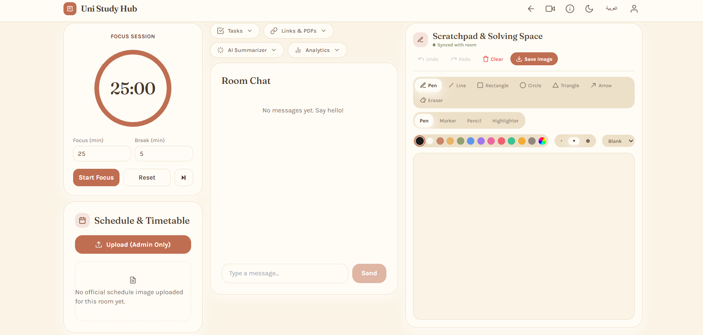

# Study Hub

A real-time collaborative study platform for students. Create a "room" with classmates and get a shared workspace: live chat, a synced whiteboard, task tracking, a Pomodoro timer, video calls, and an AI study assistant. Built as a from-scratch React rewrite of an earlier vanilla-JS version.

🔗 **Live demo:** https://study-hub-v2-app.netlify.app/



## Features
- **Study rooms:** create a room with a unique code and invite classmates to join
- **Real-time collaborative whiteboard:** draw and everyone in the room sees it live. 4 pen styles, 7 shape tools, a full color picker, and multiple background sheet types (grid, dots, ruled, graph paper)
- **Live chat:** per-room messaging, synced across members
- **Task board:** shared to-do list for the room
- **Pomodoro timer:** focus/break cycles with a circular progress ring, logged locally to power the analytics below
- **Study analytics:** streaks, total focus hours, and unlockable achievement badges, visualized with a weekly chart
- **Video calls:** one-click video chat per room (via Jitsi Meet, no account needed)
- **Links & PDFs:** share resources with the room, including direct PDF uploads
- **Class schedule:** admins can upload a schedule image visible to the whole room
- **AI Study Assistant:** paste notes and generate a summary, flashcards, or a practice quiz
- **Bilingual:** full English/Arabic support, including RTL-aware layout
- **Light/dark mode**

## Evolution: v1 to v2
This is the second version of the project. The first was a simple vanilla JavaScript site ([live demo](https://study-with-me13.netlify.app/), [code](https://github.com/4smaa13/study-with-me-v1)). I rebuilt it in React with Firebase to learn how to build a real multi-user app: accounts, shared rooms, real-time data and serverless deployment.

## Known issues
Some room features work for one user but do not sync correctly for every member of the room. I am still debugging how room data is read and shared across users.

## How it was built
This is a learning project, built with AI assistance (code generation and debugging help) while I learned React, Firebase and deployment. I chose the stack, designed the features and architecture, and am debugging and iterating on it myself.

## Tech Stack
- **React 18 + Vite:** frontend
- **Tailwind CSS:** styling, with a custom warm color-token theme (light + dark)
- **Firebase:** Authentication (email/password + Google) and Firestore (real-time data for rooms, chat, tasks, whiteboard sync)
- **Netlify Functions:** a serverless proxy that keeps the OpenAI API key server-side rather than exposed in the browser
- **Cloudinary:** image/PDF uploads
- **Jitsi Meet:** embedded video calling
- **Recharts:** analytics charts

## A few technical decisions worth calling out
- **The OpenAI key never touches the browser.** Early on, the AI Summarizer called OpenAI directly from the frontend, which would have shipped the API key to every visitor. It now goes through a Netlify Function (`netlify/functions/ai-proxy.js`) that holds the key server-side.
- **Firestore rules are scoped to room membership, not just "any signed-in user."** Reading or writing a room's chat, tasks, or whiteboard requires being a member of that room, not just having an account.
- **The whiteboard syncs in real time via a Firestore listener:** every completed stroke is pushed as an image snapshot, and all connected clients redraw when it changes.

## Getting Started

### 1. Install dependencies
`npm install`

### 2. Set up Firebase
1. Go to [console.firebase.google.com](https://console.firebase.google.com) and create a project.
2. Add a Web app (`</>`) and copy the config it gives you into a `.env` file at the project root (see variable names below).
3. In the Firebase console:
   - Authentication → Sign-in method → enable Email/Password and Google.
   - Firestore Database → create a database.
4. Deploy the included security rules: `firebase deploy --only firestore:rules`

### 3. Set up Cloudinary
Create a free account at [cloudinary.com](https://cloudinary.com) and add your cloud name and an unsigned upload preset to `.env`.

### 4. Set up the AI Summarizer (optional)
Create an API key at [platform.openai.com](https://platform.openai.com). This key is never put in `.env` with a `VITE_` prefix. It is set as `OPENAI_API_KEY` in your Netlify site's environment variables (Site configuration → Environment variables), where it stays server-side.

To test the AI feature locally, use the Netlify CLI (`netlify dev`) instead of plain `npm run dev`, so the serverless function runs alongside Vite.

### 5. Environment variables
```
VITE_FIREBASE_API_KEY=
VITE_FIREBASE_AUTH_DOMAIN=
VITE_FIREBASE_PROJECT_ID=
VITE_FIREBASE_STORAGE_BUCKET=
VITE_FIREBASE_MESSAGING_SENDER_ID=
VITE_FIREBASE_APP_ID=
VITE_CLOUDINARY_CLOUD_NAME=
VITE_CLOUDINARY_UPLOAD_PRESET=
```
(`OPENAI_API_KEY` is set on Netlify directly, not in this file.)

### 6. Run it
`npm run dev`

Visit the local URL Vite prints (usually http://localhost:5173).

## Project Structure
```
src/
  components/
    Auth/         Login, Signup, shared auth layout
    Room/         Join/Create a room
    Timer/        Pomodoro timer
    Tasks/        Task board
    Links/        Shared links + PDF uploads
    Schedule/     Class schedule image upload/viewer
    Chats/        Real-time room chat
    Video/        Jitsi video calling
    Whiteboard/   Real-time collaborative whiteboard
    Ai/           AI study assistant (summary/flashcards/quiz)
    Analytics/    Study streaks, hours, and badges
    Members/      Room member list
  context/
    AuthContext.jsx      Logged-in user state, login/signup/logout
    RoomContext.jsx      Current room state, join/create/delete/leave
    LanguageContext.jsx  EN/AR translations
    ThemeContext.jsx     Light/dark mode
  lib/
    firebase.js    Firebase app initialization
    cloudinary.js  Upload helper
  services/
    aiService.js   Calls the Netlify AI proxy function
netlify/
  functions/
    ai-proxy.js    Serverless function holding the OpenAI key server-side
```

## Deployment
Deployed on Netlify with continuous deployment from this repo. `netlify.toml` configures the build (`npm run build` → `dist`) and points Netlify at `netlify/functions` for the serverless AI proxy.
